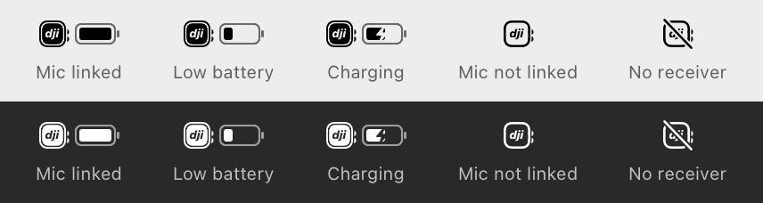
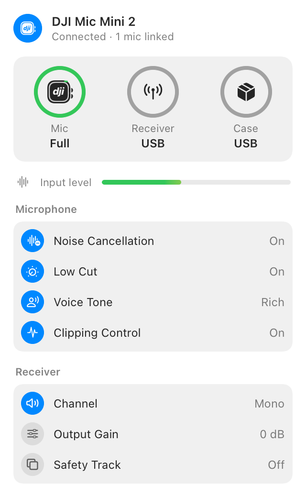
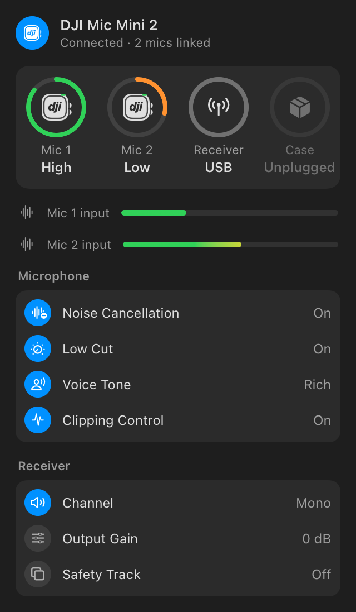

# DJI Mic Bar

A macOS menu bar app, styled like the AirPods menu, for the **DJI Mic Mini / Mic Mini 2** wireless
microphone when its receiver is plugged into your Mac over USB.



<p>
  
  
</p>

It shows:

- **Transmitter battery** (7 steps, as reported by the receiver) and charging state, per linked mic
- **What's connected**: mic(s) linked to the receiver, receiver on USB, charging case on USB
- **Live input level** per mic
- **Current settings**: noise cancellation, low cut, voice tone, clipping control, mono/stereo, gain, safety track

Everything is read-only. The app reads the receiver's vendor USB interface (libusb, statically
linked). It does not change the device configuration or touch the audio interface, so the mic keeps
working as a normal audio input.

## Requirements

- macOS 14+ (built and tested on macOS 27, Apple silicon)
- DJI Mic Mini or Mic Mini 2 receiver connected by USB-C. Other DJI Mic receivers that
  [dji-mic-mo](https://github.com/usokawa/dji-mic-mo) supports (Mic series mobile receiver, Mini 2S)
  should work but are untested.
- Xcode command line tools and `brew install libusb` to build

## Build and run

```sh
brew install libusb
./build.sh                 # -> build/DJIMicBar.app (ad-hoc signed)
open build/DJIMicBar.app
```

Copy `build/DJIMicBar.app` to `/Applications` if you want to use **Open at Login**.

## Debug modes

```sh
BIN=build/DJIMicBar.app/Contents/MacOS/DJIMicBar
$BIN --dump                  # read the receiver for 5 s, print parsed state as JSON
$BIN --log                   # print a timestamped line on every state change (until Ctrl-C)
$BIN --snapshot /tmp/snap    # render the panel from live data to PNGs
$BIN --screenshots docs/screenshots   # render README screenshots from demo states
$BIN --glyphs /tmp/glyphs.png         # render all icon variants
```

## Limitations

- **One app at a time.** Only one process can hold the receiver's control interface. Quit DJI Mic
  Bar before using the DJI web tool or `dji-mic-mo.py`, and the other way round.
- **Mic in the case shows as "not linked".** The transmitter powers off when docked, so the receiver
  stops reporting it.
- **No case battery.** Over USB the charging case only answers a firmware "get version" request and
  sends a heartbeat. Its battery level isn't exposed, so the app only shows whether the case is on USB.
- **Battery scale.** The receiver reports 7 steps; per dji-mic-mo, 1 = full and 7 = empty.

## Credits

Protocol parsing is ported from [usokawa/dji-mic-mo](https://github.com/usokawa/dji-mic-mo)
(BSD 2-Clause, see [`THIRD_PARTY_LICENSE-dji-mic-mo.md`](THIRD_PARTY_LICENSE-dji-mic-mo.md)).

DJI Mic Bar is an unofficial project and is not affiliated with or endorsed by DJI. "DJI" and
"DJI Mic" are trademarks of SZ DJI Technology Co., Ltd.
